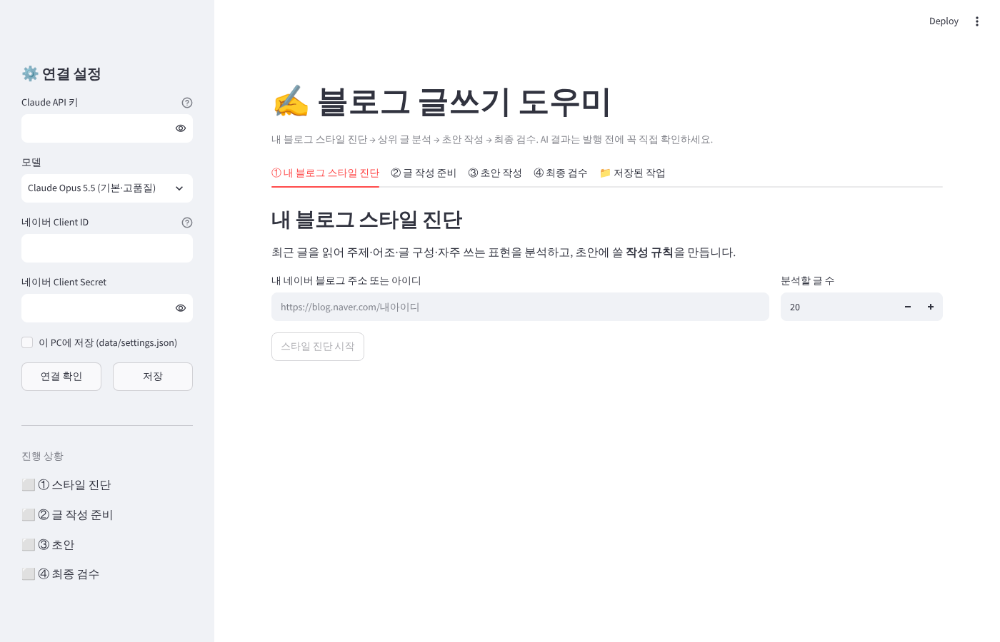

# blog-writing — 블로그 글쓰기 도우미

내 네이버 블로그의 말투를 배운 AI가 **스타일 진단 → 상위 글 분석 → 초안 작성 → 최종 검수**까지 이어서 도와주는 도구입니다.
(유튜브에서 소개된 "도톨이 AI"의 작업 흐름을 참고해 직접 만든 버전입니다. Windows 전용 설치 파일 대신 Python으로 macOS·Windows 어디서나 브라우저로 실행합니다.)



## 무엇을 하나요?

| 단계 | 하는 일 | 쓰는 것 |
|---|---|---|
| ① 내 블로그 스타일 진단 | 내 블로그 최근 글(RSS)을 읽고 주제·어조·글 구성·자주 쓰는 표현을 분석해 **초안 작성 규칙**을 만듭니다 | 네이버 RSS + Claude |
| ② 글 작성 준비 | 키워드로 네이버 블로그 검색 상위 글을 읽고 검색 의도, 꼭 다룰 정보(출처 번호 포함), 차별화 방향, 추천 제목·목차를 정리합니다 | 네이버 검색 API + Claude |
| ③ 초안 작성 | 내 스타일 + 준비 자료 + **내 실제 경험 메모**로 초안, 태그, 이미지 생성 프롬프트(5~10장)를 씁니다 | Claude |
| ④ 최종 검수 | 사실·수치, 지어낸 경험, 스타일 일치, 반복 표현, 검색 의도, 키워드 배치, 가독성을 점검하고 반영한 최종본을 만듭니다 | Claude |

모든 단계의 결과는 화면에서 직접 고칠 수 있고, 고친 내용이 다음 단계에 그대로 쓰입니다. 작업은 `data/` 폴더에 키워드별로 저장됩니다.

## 준비물

1. **Python 3.10 이상**
2. **Claude API 키** — https://console.anthropic.com → API Keys (사용한 만큼 요금이 나옵니다)
3. **네이버 검색 API 키** (무료) — https://developers.naver.com → Application → 애플리케이션 등록
   - 사용 API: **검색** 선택, 환경: **WEB 설정**에 `http://localhost` 입력
   - 발급된 **Client ID / Client Secret** 사용

## 설치와 실행

```bash
git clone https://github.com/hokyun896kim/blog-writing.git
cd blog-writing
python -m venv .venv
source .venv/bin/activate        # Windows: .venv\Scripts\activate
pip install -r requirements.txt
streamlit run app.py
```

브라우저가 열리면 왼쪽 **연결 설정**에 키를 넣고 **연결 확인**을 누르세요.
(키를 매번 넣기 싫으면 `.env.example`처럼 환경변수로 두거나 "이 PC에 저장"을 체크하세요.)

## 잘 쓰는 요령

- **③의 "내 경험·관점" 칸이 글 품질을 가장 크게 좌우합니다.** 메모처럼 짧게 써도 되니 실제로 겪은 일·숫자·느낌을 넣으세요. AI는 이 칸에 없는 경험을 지어내지 않도록 되어 있습니다.
- ②의 준비 자료에서 틀리거나 빼고 싶은 내용은 직접 지우고 **승인·저장**한 뒤 초안을 쓰세요.
- 최종본에 남은 `[확인 필요: …]` 표시는 발행 전에 직접 확인해 채우세요.
- 모델은 기본 Claude Opus 5.5이고, 더 빠르고 저렴하게 쓰려면 사이드바에서 Sonnet 5.5를 고르세요.

## 한계

- 검색 순위·방문자 수를 보장하지 않습니다. AI 분석과 글에는 오류가 있을 수 있습니다.
- 자동 발행·이미지 생성은 하지 않습니다 (이미지는 프롬프트만 만들어 줍니다).
- 비공개 블로그나 RSS를 끈 블로그는 스타일 진단을 할 수 없습니다.
- 상위 글 본문은 네이버 페이지 구조에서 추출하므로, 네이버가 구조를 바꾸면 요약문으로 대신 분석됩니다.

## 개발

```bash
pip install pytest
python -m pytest tests
```

- `blogwriter/naver.py` 검색 API·RSS·본문 추출
- `blogwriter/llm.py` Claude 호출 (스트리밍)
- `blogwriter/prompts.py` 단계별 프롬프트
- `blogwriter/storage.py` 로컬 저장
- `app.py` Streamlit 화면
