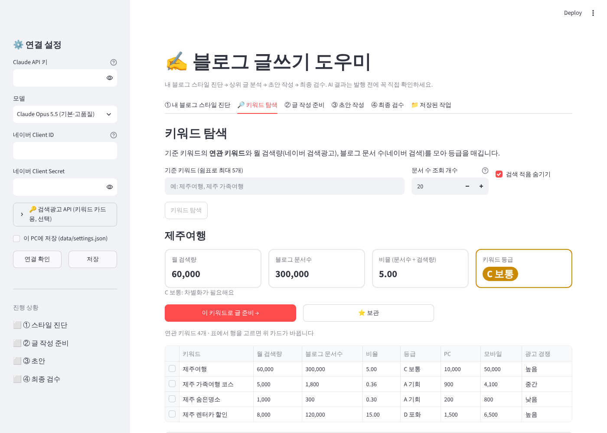

# blog-writing — 블로그 글쓰기 도우미

내 네이버 블로그의 말투를 배운 AI가 **스타일 진단 → 상위 글 분석 → 초안 작성 → 최종 검수**까지 이어서 도와주는 도구입니다.
(유튜브에서 소개된 "도톨이 AI"의 작업 흐름을 참고해 직접 만든 버전입니다. Windows 전용 설치 파일 대신 Python으로 macOS·Windows 어디서나 브라우저로 실행합니다.)


## 무엇을 하나요?

| 단계 | 하는 일 | 쓰는 것 |
|---|---|---|
| ① 내 블로그 스타일 진단 | 내 블로그 최근 글(RSS)을 읽고 주제·어조·글 구성·자주 쓰는 표현을 분석해 **초안 작성 규칙**을 만듭니다 | 네이버 RSS + Claude |
| 🔎 키워드 탐색 (선택) | 기준 키워드의 연관 키워드를 모아 **월 검색량 · 블로그 문서수 · 비율 · 키워드 등급** 카드로 보여 주고, 고른 키워드를 ②로 넘기거나 보관합니다 | 네이버 검색광고 API + 검색 API |
| ② 글 작성 준비 | 키워드로 네이버 블로그 검색 상위 글을 읽고 검색 의도, 꼭 다룰 정보(출처 번호 포함), 차별화 방향, 추천 제목·목차를 정리합니다 | 네이버 검색 API + Claude |
| ③ 초안 작성 | (선택) **문단별 작성 계획**을 먼저 보고 고친 뒤, 내 스타일 + 준비 자료 + **내 실제 경험 메모**로 초안, 태그, 이미지 생성 프롬프트(5~10장, 직전 장수 기억)를 씁니다 | Claude |
| ④ 최종 검수 | 사실·수치, 지어낸 경험, **요청·경험 반영 여부**, 스타일 일치, 반복 표현, 검색 의도, 키워드 배치, 가독성·중복 출처를 점검하고 반영한 최종본을 만듭니다 | Claude |

모든 단계의 결과는 화면에서 직접 고칠 수 있고, 고친 내용이 다음 단계에 그대로 쓰입니다. 작업은 `data/` 폴더에 키워드별로 저장됩니다.

## 준비물

1. **Python 3.10 이상**
2. **Claude API 키** — https://console.anthropic.com → API Keys (사용한 만큼 요금이 나옵니다)
3. **네이버 검색 API 키** (무료) — https://developers.naver.com → Application → 애플리케이션 등록
   - 사용 API: **검색** 선택, 환경: **WEB 설정**에 `http://localhost` 입력
   - 발급된 **Client ID / Client Secret** 사용
4. (선택) **네이버 검색광고 API 키** (무료, 키워드 카드용) — https://searchad.naver.com 가입 → 광고시스템 → 도구 → **API 사용 관리** → 네이버 검색광고 API 서비스 신청
   - **CUSTOMER_ID(고객 ID) / 액세스 라이선스 / 비밀키** 세 가지를 사이드바 "🔑 검색광고 API"에 입력
   - 광고를 집행하지 않아도 발급·조회할 수 있습니다

## 설치와 실행

```bash
git clone https://github.com/hokyun896kim/blog-writing.git
cd blog-writing
python -m venv .venv
source .venv/bin/activate        # Windows: .venv\Scripts\activate
pip install -r requirements.txt
streamlit run app.py
```

브라우저가 열리면 왼쪽 **연결 설정**에 키를 넣고 **연결 확인**을 누르세요.
(키를 매번 넣기 싫으면 `.env.example`처럼 환경변수로 두거나 "이 PC에 저장"을 체크하세요.)

## 키워드 카드 읽는 법



- **월 검색량** = PC + 모바일 월간 검색수 (네이버 검색광고 기준, 띄어쓰기 무시)
- **블로그 문서수** = 네이버 블로그 검색 결과 수
- **비율** = 문서수 ÷ 월 검색량. 낮을수록 찾는 사람에 비해 글이 적습니다
- **등급**: A 기회(< 0.5) · B 좋음(< 2) · C 보통(< 10) · D 포화(≥ 10) · E 검색 적음(월 50 미만) · 미확인(수치를 못 가져옴 — 임의로 채우지 않음)
- 비율과 등급은 참고용이며 **검색 상위노출 확률이 아닙니다**
- 문서수는 검색 API를 키워드마다 1번 호출합니다 (하루 25,000회 한도). 기본은 검색량 상위 20개만 조회하고, 나머지는 카드에서 "문서 수 조회"로 개별 조회합니다

## 잘 쓰는 요령

- **③의 "내 경험·관점" 칸이 글 품질을 가장 크게 좌우합니다.** 메모처럼 짧게 써도 되니 실제로 겪은 일·숫자·느낌을 넣으세요. AI는 이 칸에 없는 경험을 지어내지 않도록 되어 있습니다.
- ②의 준비 자료에서 틀리거나 빼고 싶은 내용은 직접 지우고 **승인·저장**한 뒤 초안을 쓰세요.
- 요청이나 경험이 여러 개면 ③에서 **작성 계획 만들기**를 먼저 눌러, 각각이 몇 번 문단에 들어가는지 확인하세요.
- 출처 링크는 뉴스·공식 자료(②의 "추가로 참고할 글 주소")만, 처음 쓴 곳에 한 번씩 답니다. 다른 블로거 글은 출처로 달지 않습니다.
- 최종본에 남은 `[확인 필요: …]` 표시는 발행 전에 직접 확인해 채우세요.
- 모델은 기본 Claude Opus 5.5이고, 더 빠르고 저렴하게 쓰려면 사이드바에서 Sonnet 5.5를 고르세요.

## 한계

- 검색 순위·방문자 수를 보장하지 않습니다. AI 분석과 글에는 오류가 있을 수 있습니다.
- 자동 발행·이미지 생성은 하지 않습니다 (이미지는 프롬프트만 만들어 줍니다).
- 비공개 블로그나 RSS를 끈 블로그는 스타일 진단을 할 수 없습니다.
- 상위 글 본문은 네이버 페이지 구조에서 추출하므로, 네이버가 구조를 바꾸면 요약문으로 대신 분석됩니다.

## 개발

```bash
pip install pytest
python -m pytest tests
```

- `blogwriter/naver.py` 검색 API·RSS·본문 추출
- `blogwriter/keywords.py` 검색광고 API(월 검색량)·키워드 등급
- `blogwriter/llm.py` Claude 호출 (스트리밍)
- `blogwriter/prompts.py` 단계별 프롬프트
- `blogwriter/storage.py` 로컬 저장
- `app.py` Streamlit 화면
